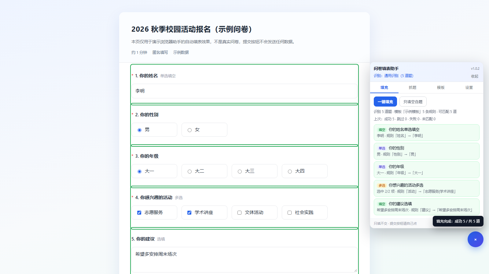
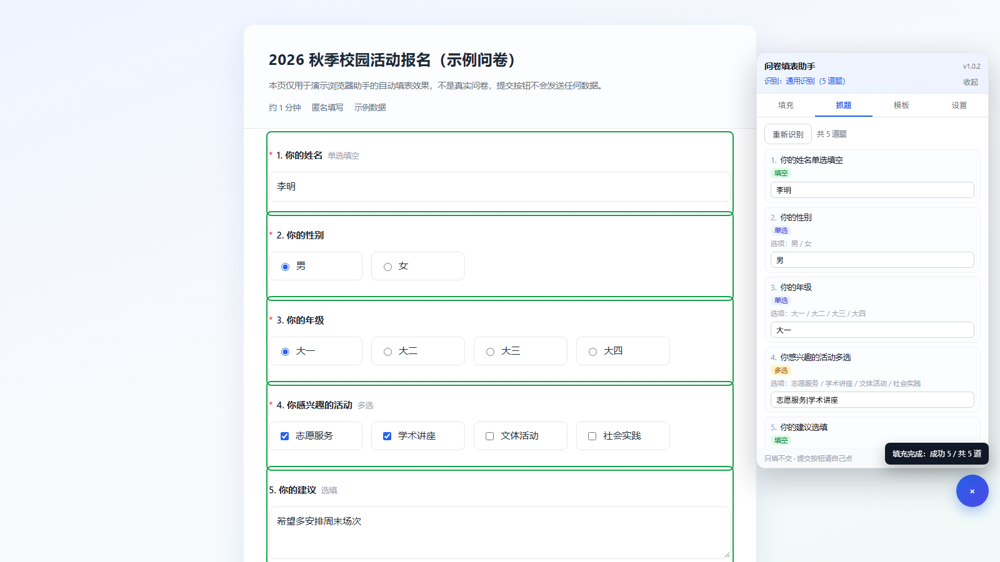

# Survey Autofill Helper

**Stop retyping the same answers.** Save your answers once as a template, then fill 问卷星 (WJX), 腾讯问卷 (Tencent Survey), WPS 表单 (WPS Forms) and other Chinese survey forms with one click.

> One rule: it fills, **never submits**. You always review and click “提交” yourself.

[中文说明](README.zh-CN.md) · [Changelog](CHANGELOG.md)



---

## Why

Chinese survey forms (问卷星, 腾讯问卷, WPS 表单, 金数据 …) all have their own DOM, so every “auto-fill” script breaks on the next platform. This one keeps a small **template engine** (question keyword → answer) and platform **adapters** for the big three, with a generic fallback for the rest.

Typical use: you fill the same kind of form again and again — class surveys, volunteer sign-ups, club registrations, weekly reports. Type the answers once, reuse them forever.

## Features

- **Answer templates** — store multiple templates, switch per form, edit rules inline, export / import JSON.
- **Scan mode** — lists every detected question with its type and options, then lets you write answers and save them as a template.
- **Per-question feedback** — green outline = filled, red = failed, grey = skipped, with a reason for every question.
- **Only-fill-blank mode** — never overwrite what you already typed.
- **Random answers** — `随机` / `随机2` for multi-select, useful for practice forms.
- **Works offline** — no network calls, no telemetry; templates live in Tampermonkey storage.

## Supported platforms

| Platform | Status | Notes |
| --- | --- | --- |
| 问卷星 WJX (`wjx.cn`, `wjx.top`, `sojump.com`) | ✅ Verified | radio / checkbox / text / dropdown, 30-question real form |
| 腾讯问卷 Tencent Survey (`wj.qq.com`) | ✅ Verified | radio / checkbox / text, real form |
| WPS 表单 WPS Forms (`f.wps.cn`) | ✅ Verified | radio / checkbox / text / antd dropdown |
| Generic fallback (金数据, 问卷网, 麦客 …) | ⚠️ Best effort | common `label + input` structures |

Matrix, ranking, file-upload, date and region pickers are reported as “fill manually” instead of being guessed.

## Install

1. Install [Tampermonkey](https://www.tampermonkey.net/) in Edge / Chrome.
2. Install this script — drag `survey-autofill-helper.user.js` into the browser window, or open the raw file and click **Install**:

```
https://raw.githubusercontent.com/MingNin9466/survey-autofill-helper/main/survey-autofill-helper.user.js
```

3. Open a survey page and reload once. A blue **填** button appears at the bottom-right.

## Quick start

1. Open the survey fill page (not the editor / preview page).
2. Click **填** → **抓题** (Scan). Every question is listed with its type and options.
3. Type your answer under each question, then **存为新模板** (save as template).
4. Next time: **填充** → **一键填充** (fill all), check the result, submit manually.



## Answer syntax

| Answer | Meaning |
| --- | --- |
| `男` | match the option text (ignores `A.` prefixes, punctuation, spaces) |
| `A` / `#2` | pick by option letter / index |
| `随机` | pick a random option |
| `随机2` | pick 2 random options (multi-select) |
| `音乐\|运动` | multi-select: several answers separated by `\|` (also `,` `、`) |
| `暂无` | fill-in question: write this text |
| `性别\|身份` in the keyword field | match any of several keywords |

Matching normalises both sides: question numbers, `（单选）`, `（必填）`, punctuation and whitespace are ignored, so templates survive small wording changes.

## How it works

```
survey page
   │
   ├─ adapter (wjx / qq / wps / generic)  →  [{ title, kind, options, textEls }]
   ├─ template rules                      →  keyword match (normalised)
   └─ fill engine                         →  click labels / set values, verify state
```

- Platform adapters only read the DOM; they do not call private APIs.
- Fill verification re-reads the control state after clicking, so a “success” means the option is really selected.
- The panel lives in a Shadow DOM; keys, paste and context-menu events are stopped at the panel boundary, so site-level handlers (for example WJX blocking Backspace) cannot interfere.

## FAQ

**The 填 button doesn’t appear.**
Reload the page after installing. If it still doesn’t, open the console and look for `[问卷填表助手] v1.0.2 已加载` — no line means the domain isn’t matched or the script is disabled.

**WPS 表单 says it needs a login.**
WPS Forms often require a WPS account. Log in first; the script then sees enabled inputs. Closed forms (“已达上限 / 停止收集”) cannot be filled by anyone — the owner turned collection off.

**A question is marked “请手动填写”.**
Matrix, ranking, file upload, date and region questions are intentionally not automated.

**Long survey / paginated survey.**
Scroll to the bottom once and re-scan; for multi-page forms fill one page, click 下一页, then fill again.

## Limitations

- No auto-submit, ever — by design.
- Matrix / ranking / upload / date / region questions are manual.
- Forms with collection limits or login walls are out of scope.
- DOM changes on a platform can break its adapter; issues with a page URL are welcome.

## Privacy & safety

- No network requests, no analytics, no external services.
- Everything is stored locally via `GM_setValue`.
- Intended for filling your own forms faster. Do not use it to fabricate survey data or bypass collection limits.

## Development

```
demo/demo.html        a neutral demo survey (used for screenshots)
demo/capture.cjs      headless Edge script that renders the panel and saves screenshots
```

The userscript is a single file: `survey-autofill-helper.user.js`.

## License

[MIT](LICENSE) © 2026 Survey Autofill Helper contributors
